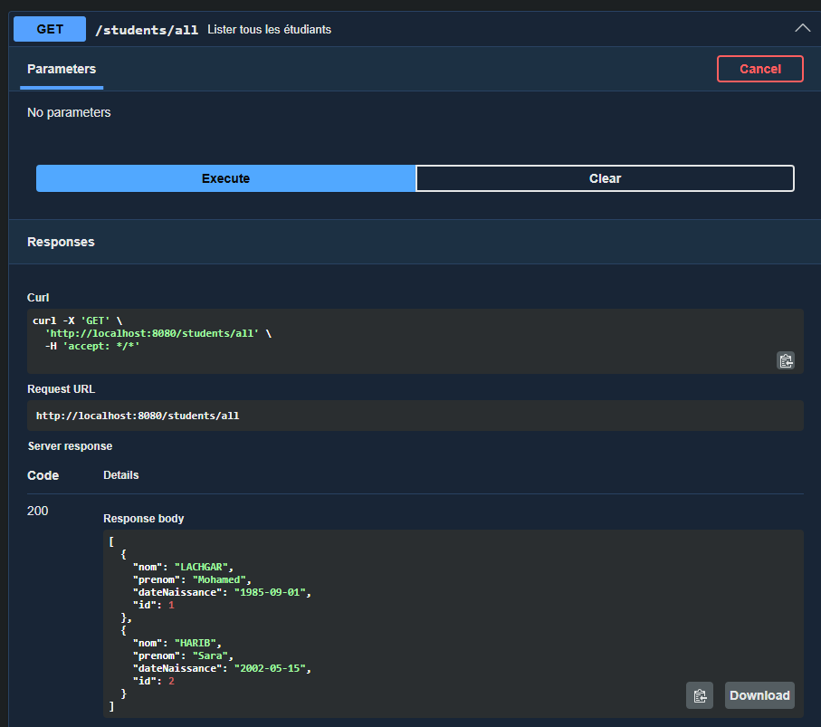
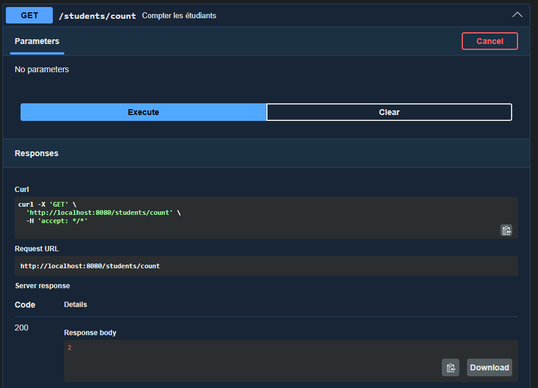
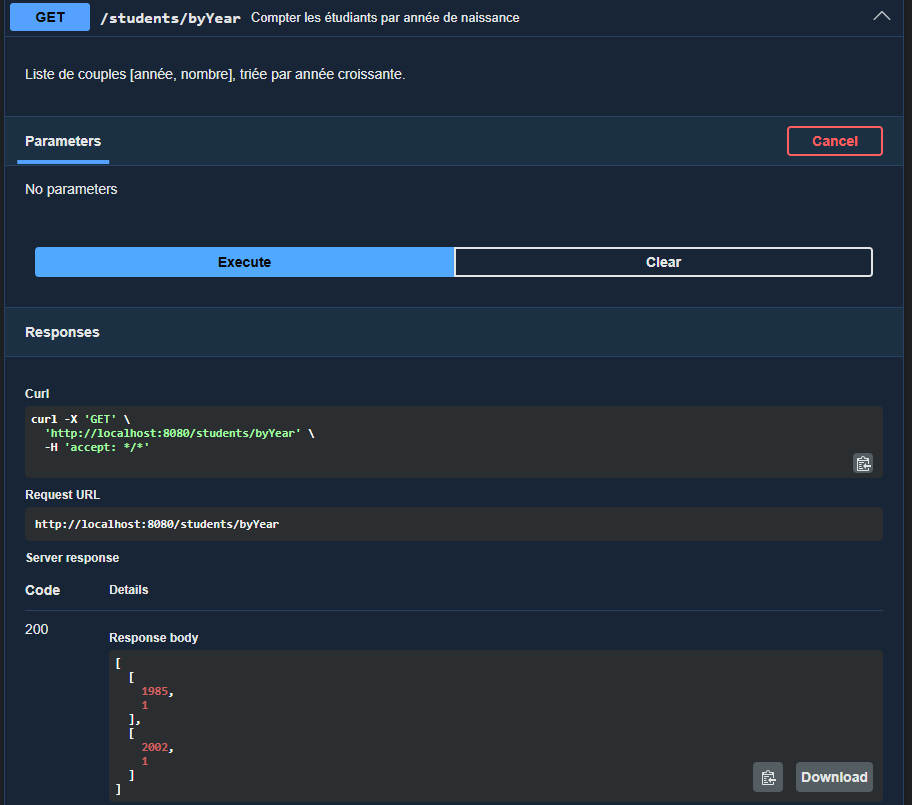
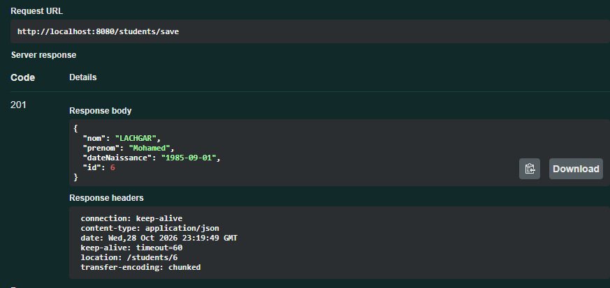
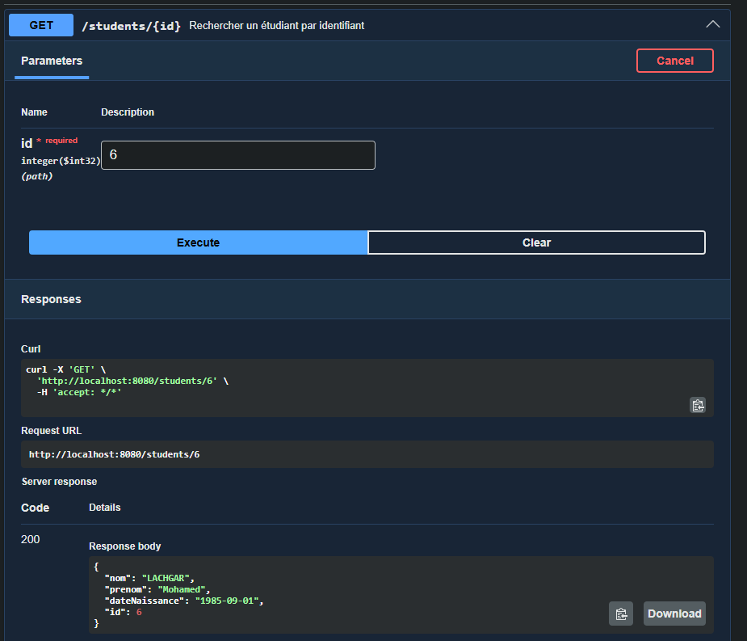
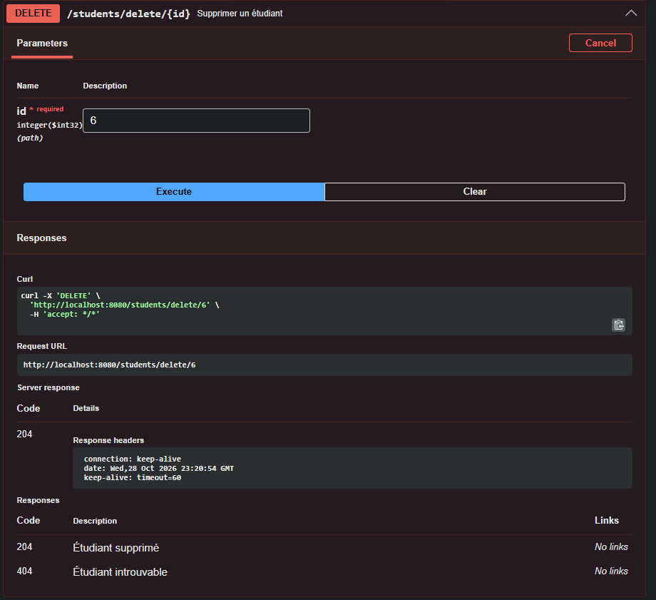

# Gestion des étudiants — API Spring Boot

J'ai réalisé cette API REST pour pratiquer le développement backend avec Spring Boot, JPA et Swagger. Elle permet de gérer des étudiants et de consulter quelques statistiques simples.

## Fonctionnalités

- Ajouter, consulter, modifier ou supprimer un étudiant.
- Consulter la liste et le nombre total d'étudiants.
- Regrouper les étudiants par année de naissance.
- Valider les données reçues et renvoyer des réponses HTTP adaptées (400, 404, etc.).

## Technologies

Java 21 · Spring Boot · Spring Data JPA · MySQL/MariaDB · Swagger/OpenAPI · JUnit · Mockito · MockMvc · Maven

## Structure

- `controller` : endpoints HTTP et validation des requêtes.
- `service` : logique applicative.
- `repository` : accès aux données avec JPA.
- `entity` : modèle étudiant.
- `src/test` : tests de contrôleur et de service.

## Lancer le projet

Prérequis : **Java 21**, **Maven** et **MySQL/MariaDB**.

La configuration actuelle dans `src/main/resources/application.properties` utilise une base locale `studentdb` sur le port **3308**. Avant de démarrer, adaptez l'URL et les identifiants à votre installation locale. N'utilisez pas de vrais identifiants de production dans le dépôt.

```bash
./mvnw spring-boot:run
```

Sous Windows, utiliser `mvnw.cmd spring-boot:run`.

Une fois démarrée, l'API est accessible sur `http://localhost:8080`. La documentation Swagger UI se trouve normalement sur `http://localhost:8080/swagger-ui/index.html`.

Quelques routes : `GET /students/all`, `GET /students/{id}`, `POST /students/save`, `PUT /students/{id}`, `DELETE /students/delete/{id}`.

## Tests

Le projet contient des tests JUnit avec Mockito : ils couvrent notamment les réponses HTTP, les données invalides, les cas introuvables, et les opérations du service. Les tests de contrôleur et de service utilisent des dépendances simulées et n'ont pas besoin de MySQL. Le test `StudentManagementApplicationTests.contextLoads()` démarre l'application et **nécessite une base MySQL/MariaDB accessible** avec la configuration de `application.properties` (ou des variables d'environnement adaptées).

```bash
./mvnw test
```

Sous Windows, utiliser `mvnw.cmd test`. Le résultat doit être vérifié localement ; je ne présente pas ces tests comme validés par CI.

## Captures

**Consultation et statistiques**





**Création et opérations CRUD**





---

Ce projet m'a permis de travailler sur la séparation des responsabilités, la validation d'une API REST et les tests de la logique applicative.
